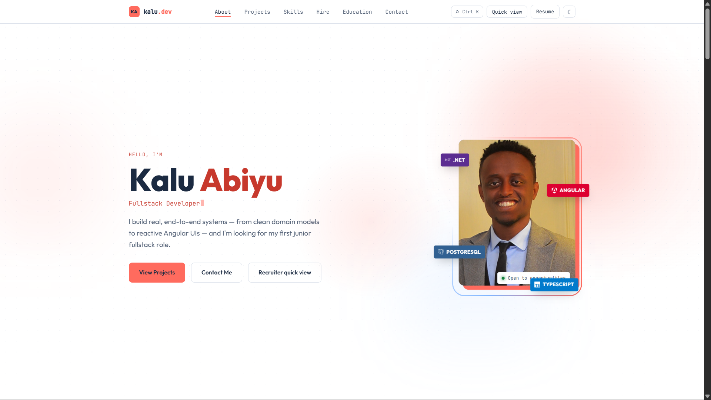
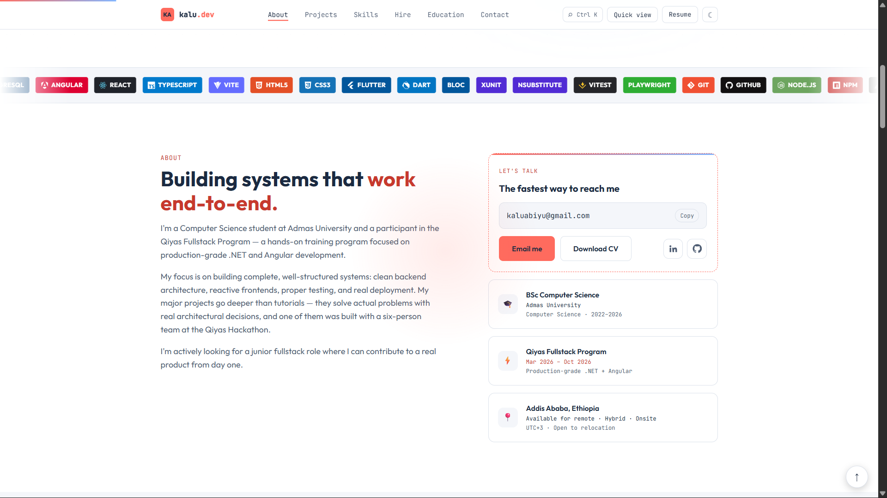
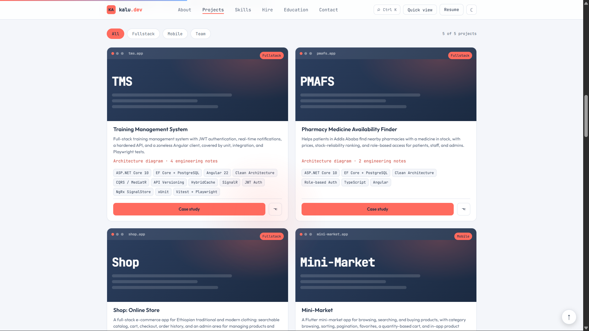
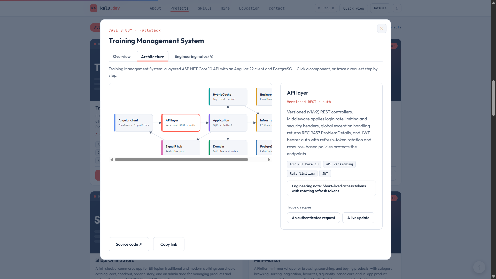
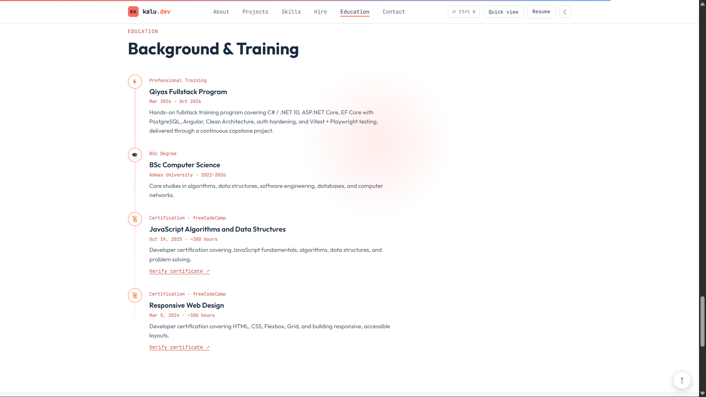
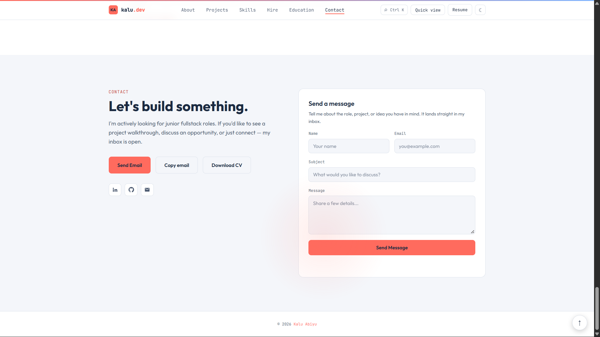

# Kalu Abiyu: Developer Portfolio

Personal portfolio built with React 18, TypeScript and Vite. Content lives in
`src/data.ts`, so updating a project or a skill does not require touching the
components.

**Live site:**  http://localhost:5173/

## Screenshots

## Features
Animated 2D hero (aurora background, rotating halo ring, floating tech badges that follow the mouse),
scroll-reveal animations, 3D-tilt project cards, animated counters, tech marquee, scroll progress bar,
cursor spotlight, live Addis Ababa clock, a copy-email quick-contact card and a "How I build" section linked to the case studies.
All motion is switched off for visitors who prefer reduced motion.

Dark/light theme that follows the system setting, case-study modal with shareable deep links (`/#case/<project-slug>`, Back button supported) built on the
native `<dialog>` element, a combined Hire and CV section (facts recruiters ask for first, beside a one-page CV preview with download), contact form delivered through FormSubmit (validation, honeypot spam trap, 60 s send cooldown, auto-reply to the sender, mailto fallback), JSON-LD
structured data, optional Plausible analytics.

## Run locally
    npm ci
    npm run dev        # development server
    npm run build      # type-check with tsc, then production build into dist/
    npm run preview    # serve the production build locally

## Configuration
Copy `.env.example` to `.env.production` and set `VITE_PLAUSIBLE_DOMAIN` to
enable analytics. Leave it empty to disable.

## Architecture and engineering notes
Each project's case study (open a project card) has up to three tabs: Overview, Architecture and Engineering notes.
`src/engineeringData.ts` holds both the notes (`STUDIES`, matched to projects by `Project.short`) and the diagrams
(`ARCHITECTURES`: nodes on a 4x3 grid, edges and step-by-step request traces). Add a note or a component there and it appears
in the right project's modal. Deep links: `/#case/<project-slug>`, `/#case/<project-slug>/architecture`, `/#case/<project-slug>/engineering`.

## Recruiter quick view
A plain, animation-free, high-contrast summary at `/#recruiter` (button in the nav bar, hero and Ctrl/Cmd+K palette).
It reads from the same data as the main page (`ONE_LINERS` in `src/data.ts` for the project summaries) and prints cleanly.

## Hire and CV
The Hire section shows `public/cv-preview.webp` and links to `public/Kalu_Abiyu_CV1.pdf`.
After replacing the PDF, run `scripts/cv-preview.sh` (needs `pdftoppm` and Python Pillow) to refresh the thumbnail,
and edit `HIRE_FACTS` in `src/data.ts` so the facts match (the "looking" rows also feed the recruiter quick view). `/#cv` still scrolls to the preview.

## Contact form (one-time activation)
The form posts to FormSubmit, which forwards messages to `PROFILE.email`. Deploy the site, send one test message
from it, then click the activation link FormSubmit emails to that address. Until then sends fail and the form
falls back to opening the visitor's email app. Optionally set `VITE_FORMSUBMIT_ID` (see `.env.example`) to the
alias FormSubmit gives you so your address is not visible in network requests.

## Deploy
Build command `npm run build`, output directory `dist`.